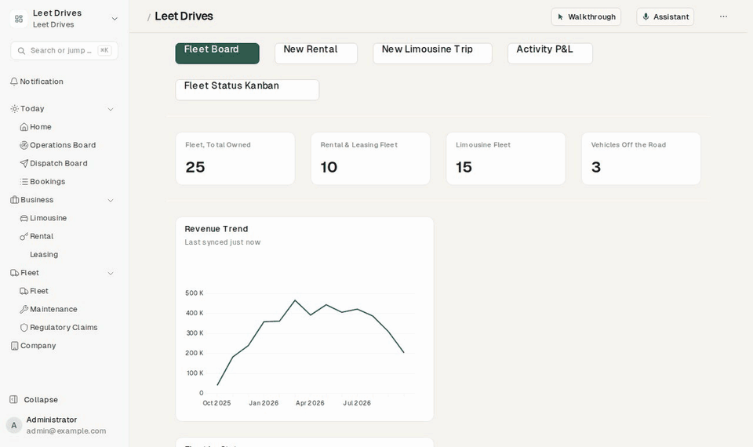

# Frappe Walkthrough



*"Create a Fleet Vehicle", generated from the DocType itself: the cursor goes to the list through the sidebar and presses Add. At each field it waits for the viewer to type, then points at Save.*

Animated walkthroughs for any Frappe or ERPNext desk, with optional AI help.

Every desk page gets a **Walkthrough** button. Its panel lists what can be done on that page first, then every walkthrough by category. Playing one moves an animated cursor across the real screen: it glides to each control, shows the press, and really clicks it.

- **No jumping.** It reaches each screen the way a person would, through the sidebar or by typing the name into the search bar, so the viewer learns the way.
- **Create walkthroughs are interactive.** They stop at each field and wait for the viewer to type, then ask for everything else the form requires, then wait for Save and Submit.
- **Out of the box.** Walkthroughs are generated from your own DocTypes, reports and workspaces, including custom apps and custom fields.
- **Process walkthroughs.** It follows your documents' own Create buttons, dashboards and links to find chains like Quotation → Sales Order → Delivery Note → Sales Invoice → Payment, and builds a walkthrough that carries one document into the next. These are drafts for you to check and switch on.
- **Record your own.** Do the task once and it becomes a walkthrough: pages, new records, fields, Save, Submit, Create → next document. Captions are written for you.
- **Any language.** Captions are built in every language you choose, using Frappe's own translations plus 24 shipped languages for the app's own sentences.
- **Optional AI.**
  - An **Ask box** ("how do I invoice a customer?") where TypeSafe's Jev picks the right walkthrough. It only chooses from your list and never writes text.
  - A **Writer** (OpenAI, Azure OpenAI, Anthropic or any OpenAI-compatible endpoint) that, when you press Load, writes missing summaries and translations.
- **Your design.** Colours, sizes, font, panel side and speed are all set in the settings, with a live preview.
- Works on **Frappe v15 (`/app`) and v16 (`/desk`)**.

---

## Install

```bash
cd ~/frappe-bench
bench get-app https://github.com/<you>/frappe-walkthrough   # or copy it into apps/
bench setup requirements                                     # or: ./env/bin/pip install -e apps/frappe_walkthrough
bench build --app frappe_walkthrough
bench restart              # new Python packages are only seen after a restart
bench --site <site> install-app frappe_walkthrough
```

Install runs a first **Load** in the background, so the button and walkthroughs appear within a minute. If the button doesn't appear, reload the page.

> Restart *before* `install-app` on a live site. Web and background workers that started before the package existed can't import it, and once the site lists the app, every request fails until they restart.

## Settings (`/app/walkthrough-settings`)

### Content
| Setting | What it does |
|---|---|
| **Load walkthroughs** | Builds everything in scope and adds walkthroughs that apps ship. Safe to run again: walkthroughs **edited by hand are never overwritten**; ones no longer produced are switched off, never deleted. Runs in the background with progress. |
| Import Form Tours | Turns Frappe's own Form Tours into walkthroughs. |
| Remove generated | Deletes generated walkthroughs that weren't edited. |
| Modules | What to cover. Empty means every module of your installed apps, ERPNext and HR included; tick *Include Frappe's own modules* to add users, roles and settings. |
| Only DocTypes and reports listed in a workspace | On by default: covers what people can actually reach from the sidebar. Each workspace becomes a category. |
| Also cover / Never cover | Add or remove individual DocTypes. |
| No Create walkthrough for these | Records the system writes (logs, ledger entries), or that already have a hand-written Create walkthrough. They still get a Find-and-read one. |
| Create / Find-and-read / Report walkthroughs | Which kinds to generate. |
| Fields to ask for | How many key fields a Create walkthrough stops at before "anything else the form needs" (default 6). |
| Process walkthroughs | Finds the chains of documents in scope, from Create buttons, dashboards and links back, scored by how much the site uses each document. With a Writer, it also picks the chains a business really follows, chooses the fields worth stopping at, and writes the words. Saved as **drafts** (switched off) unless *Switch process walkthroughs on without review* is ticked. |
| Drafts, Check drafts | Lists the process walkthroughs with Play, Edit and Switch on. **Check drafts** opens each draft's pages and new forms in your browser, looks for every field, tab and button it points at, and records the result. Nothing is saved. |
| The "Find your way around" tour | A short generic tour of the sidebar, search and this button. |
| Languages | Captions are built in each. Empty means the system language plus your users' languages. |

### AI
| Setting | What it does |
|---|---|
| Show the Ask box, Jev API key | "How do I…" in the user's own words, in any language. One choice question over your walkthroughs (up to 254 per question: the current page's, then the current workspace's, then the rest). |
| Play automatically at confidence | Default 0.6. Below that, the match is offered as "Not sure, is it this one?". On sites with many walkthroughs, 0.5 often works better. |
| Writer: provider, model, API key, endpoint | Used **only when Load runs**, never while people use the desk. It never sees business data, only DocType names, labels and captions. Every answer is kept for the site in `private/walkthrough_ai.json`, so running Load again costs nothing for what's already known. |
| Write summaries | One plain sentence for DocTypes and reports that have no description. |
| Translate captions | Fills labels Frappe can't translate (a custom app's own words), the app's sentences for languages it doesn't ship, and hand-written captions. |
| Test buttons | Check the Jev key and the writer. |

### Recording a walkthrough
System Managers and anyone with the **Walkthrough Manager** role see **Record a walkthrough** at the bottom of the panel.

1. Start recording; a bar at the top counts the steps.
2. Do the task as you normally would.
3. Press Stop. The steps appear with a caption each, written from the field labels. With a Writer set up, *Write the captions* asks it for better ones.
4. Name it and save. It's switched on straight away.

The recorder also handles quick-entry dialogs, and it carries on if the page reloads.

### Design
Button label, which page types show it (workspaces, lists, forms, reports, other pages), and which roles see it. Panel side and width. Accent colour and font. Cursor colour and size. Highlight-ring colour and how much to dim the page. Caption background, text colour, width and corner radius. Speed (slow / normal / fast) and reduced motion. **Preview the design** plays a short demo with the values on the form, saved or not.

On pages without a page header (v16's app grid at `/desk`), the button floats in a bottom corner.

---

## For app developers

### Ship walkthroughs with your app

In your app's `hooks.py`:

```python
walkthroughs = ["my_app.walkthroughs.get"]                 # hand-written walkthroughs
walkthrough_summaries = ["my_app.walkthroughs.summaries"]  # {"DocType or Report": {"en": "...", "ar": "..."}}
walkthrough_terms = ["my_app.walkthroughs.terms"]          # {"ar": {"Plate Code": "كود اللوحة"}}
walkthrough_categories = ["my_app.walkthroughs.categories"]  # {"DocType, Report or Workspace": "Category"}
```

```python
def get():
    return [{
        "key": "order-to-invoice",            # stable id
        "title": "From order to invoice", "title_ar": "من أمر البيع إلى الفاتورة",
        "kind": "Process",                    # Process / Create / Read / Report / Board / Tour
        "category": "Selling",
        "summary": "Make a Sales Order, deliver it and invoice it.",  # the Ask box matches on this
        "contexts": ["Workspace:Selling", "DocType:Sales Order"],     # where it shows under "On this page"
        "steps": [
            {"action": "go", "route": "sales-order", "say": "Sales Orders live in Selling.", "say_ar": "…"},
            {"action": "new", "ref_doctype": "Sales Order", "say": "Add starts a new order."},
            {"action": "input", "target": "field:customer", "say": "Choose the customer."},
            {"action": "fill", "say": "Now the rest the order needs."},
            {"action": "save", "say": "Save it as a draft."},
            {"action": "submit", "say": "Submit it to confirm the order."},
            {"action": "click", "target": "btn:Create", "say": "Create → Delivery Note ships it."},
        ],
    }]
```

You can give any language next to the English: `title_<lang>`, `summary_<lang>`, `say_<lang>`, or a `translations` dict.

### Steps

| Action | Needs | What the player does |
|---|---|---|
| `go` | `route` | Reaches the page visibly: a sidebar link (unfolding its group first), else the search bar. Routes are desk-relative (`sales-order`, `query-report/General Ledger`); a leading `/app/` or `/desk/` is accepted. |
| `open` | `ref_doctype` | Goes to the list and clicks a row. If a record of that kind is already on screen, it uses that one. |
| `new` | `ref_doctype` | Goes to the list, presses Add, and opens the **full** form (never quick entry). |
| `click` / `point` | `target` | Glides to it and highlights it; `click` also presses it. |
| `input` | `target` | Clicks into the field and **waits** for the viewer: Enter (Ctrl+Enter in text areas), a choice, a date, or Next for tables. |
| `fill` | none | Every still-empty required field, in form order, re-checked after each answer. |
| `save` / `submit` | none | Points at the button and waits until the document is saved or submitted. |
| `make` | `target` (`menu:<group>/<item>`), `ref_doctype` | Opens the form's Create menu, picks the item, and waits for the new document, with everything carried over. If the menu isn't there because the document wasn't saved and submitted, it says so and skips that document's steps. |
| `tab` | `label` | Opens a form tab. |
| `type` | `target`, `text` | Draws text over a field without setting it (read-only demos). |
| `key` | `text` | `Escape` closes dialogs. |
| `say` | none | A caption only. |

| Target | Finds |
|---|---|
| `field:<fieldname>` | A form field on the visible page |
| `tab:<label>`, `btn:<text>`, `menu:<group>/<item>` | A form tab, a page-head button, a Create-menu item |
| `primary`, `title`, `row`, `filters`, `menu` | The page's primary action, title, first list row, filter area, menu |
| `report-filters`, `report-table` | A query report's filters and table |
| `sidebar`, `sidebar:<label>`, `search` | The sidebar, a sidebar item, the search bar |
| `css:<selector>` | Anything else (custom pages, boards) |

### A desk with its own layout

If your app replaces the sidebar, teach the player its way around. In your app's own JS bundle:

```js
$(document).on("app_ready", () => {
    if (!window.frappe_walkthrough) return;
    frappe_walkthrough.nav.register({
        rails() { return [...document.querySelectorAll(".my-sidebar")]; }, // where links live
        async reach(route, step) { /* click your way there; return true if you did */ return false; },
        async open_search(say) { /* open your search, return its <input> */ },
    });
});
```

Anything you don't override uses the stock driver (`frappe_walkthrough.wt.STOCK_NAV`).

### Using the player from your own code

`frappe_walkthrough.wt` has the full player: `play_key(key)`, `act.go({route})`, `act.new({doctype})`, `find("field:x")`, `move_to(x, y)`, `press(x, y)` and `ring(el)`. Set `wt.quiet = true` to drive the cursor without its caption (for example, from your own assistant).

### API

`frappe_walkthrough.api.catalogue(context, workspace, lang)`, `get(key, lang)`, `ask(question, context, workspace, lang)`. Settings actions (System Manager only): `load`, `load_status`, `remove_generated`, `import_form_tours`, `test_jev` and `test_writer`.

---

## Languages

Captions are stored in English, plus a translation for every chosen language. Generated sentences combine a template ("Choose the {0}.") with a label ("Customer"), each translated separately:

1. your app's `walkthrough_terms`;
2. this app's `i18n/<lang>.json` (ar, bn, de, es, fa, fr, hi, id, it, ja, ko, ml, nl, pl, pt, ru, sw, ta, te, th, tr, ur, vi, zh);
3. the Writer's translations for this site;
4. Frappe's own translations (every DocType name, field label and tab, in every language Frappe ships);
5. English.

Right-to-left languages switch the panel and captions to RTL. Viewers can switch language in the panel.

## Testing

- `frappe_walkthrough.qa.session.sid`: a desk session id for a headless browser.
- `frappe_walkthrough.qa.writer_check.run`: checks the Writer.
- `frappe_walkthrough.qa.process_check.run --kwargs '{"app": "erpnext"}'`: prints the document chains the process finder sees (writes nothing).
- `frappe_walkthrough.qa.form_tour_check.run`: imports a throwaway Form Tour, checks the result, and removes both.
- `frappe_walkthrough.qa.build_i18n.run`: tops up the shipped translations (maintainers).

To check playback, play each walkthrough in a headless browser and press Next whenever the player waits. Fail on any target not found, any `go` that doesn't land on its route, and any JS error.

## Frappe v15 and v16

The player works out `/app` or `/desk` from the URL. Scope reads v16 Workspace Sidebars when they exist, and Workspace links and shortcuts on both versions. Search works with v16's search dialog and v15's navbar search. Developed and tested on v16; v15 support is written in but **hasn't been run on a v15 bench yet**.

## Traps this app works around

- **Typed dates were wiped** in every Date field: Frappe's date picker rewrote the input while you typed. `date_typing.js` fixes this for the whole desk.
- **Link fields' autocomplete swallows Enter**, so the player listens on the document in the capture phase.
- **`offsetParent` is null for fixed elements** such as the search bar and sidebars, so visibility is checked by bounding rectangles.
- **The list view keeps a hidden copy of fields behind the form**, so every lookup is scoped to the visible page.

## License

MIT
